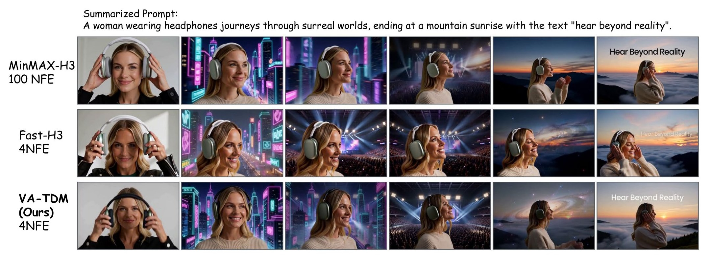

# VA-TDM: A Unified View for Improving Few-Step Diffusion Models by Velocity Adversarial Distillation

<p align="center">
  <a href="https://luo-yihong.github.io/VA-TDM/"></a>&ensp;
  <a href="https://luo-yihong.github.io/VA-TDM/#videos"></a>
</p>

This is the Official Repository of "[**VA-TDM: A Unified View for Improving Few-Step Diffusion Models by Velocity Adversarial Distillation**](https://luo-yihong.github.io/VA-TDM/)", by *Yihong Luo, Tianyu Pang, Tianyang Hu*.

<table align="center">
  <tr>
    <td align="center" width="100%"></td>
  </tr>
  <tr>
    <td colspan="2" align="center">
      Frames from <b>33B MiniMax-H3</b> audio-video generation. <b>VA-TDM-H3 (4 NFE)</b> delivers significantly better visual quality and suffers less oversaturation than the few-step competitor Fast-H3 (4 NFE), closely approaching the 100-NFE teacher.<br>
      👉 <b><a href="https://luo-yihong.github.io/VA-TDM/#videos">Visit our Project Page to watch the synchronized 10s audio-video samples with sound!</a></b>
    </td>
  </tr>
</table>

## Table of Contents

- [Method](#method)
- [Main Results](#main-results)
- [Usage](#usage)
- [Start Training](#start-training)
  - [1. Install & Environment](#1-install--environment)
  - [2. Prepare Models](#2-prepare-models)
  - [3. Launch Training](#3-launch-training)
  - [4. Hyper-parameter Recipes](#4-hyper-parameter-recipes)
    - [Core Loss Coefficients](#core-loss-coefficients)
- [Repository Structure](#repository-structure)
- [Acknowledgement](#acknowledgement)
- [Contact](#contact)
- [Bibtex](#bibtex)

## 🔥News
- (2026/11) Training code for **VA-TDM** and compatible **OT-ODE warm-up** is released.

## Method

Few-step distillation seeks to make diffusion and flow models efficient without sacrificing generation quality. While score-based distribution matching methods provide a strong foundation, accurately tracking the student's evolving distribution across intermediate few-step transitions remains challenging: direct score estimation on perturbed intermediate outputs suffers from high variance, whereas clean-target denoising can estimate a different distribution from the one used to update the student.

Building on a flow-matching perspective, we introduce **Velocity Adversarial Distillation (VAD)**, a unified framework that constructs student velocity fields along the sampling process and uses a learned critic to turn student–teacher velocity discrepancies into generator feedback. VAD unifies score distillation, Fisher-based matching, and conditional moment matching along two axes (*which field to match* and *how to update the generator*):
- **Dual-Form Velocity Game with a Shared Backbone:** Combines the low-variance **A-form** (rectified velocity capturing the conditional clean-prediction moment) and the distribution-exact **B-form** (score-equivalent Gaussian velocity for the student's perturbed distribution) via a shared auxiliary backbone (`fake` LoRA adapter) with joint output heads.
- **Transition-Aware Field Estimation:** Injects the target transition timestep $s = t_{k-1}$ (`time_text_embed_2`) into the online velocity network $h_\psi(x_\tau, \tau, s)$, enabling accurate tracking of distinct distributions induced by different student steps.
- **Path / Flow-Product Mixed Generator Updates:** Blends detached pathwise updates and flow-product updates controlled by $\lambda_b$ (`config.lambda_b`) to balance the adversarial velocity game.
- **Online Field Regularization & Critic Correction:** Regularizes the online student field toward the pre-trained teacher velocity with weight $\lambda_r$ (`config.lambda_reg_r2`) and applies the regularization-corrected critic alongside rescaled teacher CFG $1 + \frac{w - 1}{1 + \lambda_r}$.

We refer to our [Project Page](https://luo-yihong.github.io/VA-TDM/) for more details.

## Main Results

At **4 NFE**, **VA-TDM** consistently outperforms competing few-step distillation baselines across compositional prompt following, visual text rendering, image quality, human preference, and sample diversity on both SD3.5-Medium and FLUX.2-Klein-Base 4B. Furthermore, VA-TDM scales effectively to the 33B audio-video model **MiniMax-H3**, achieving a **61.33%** preference win rate over Fast-H3 at 4 NFE and **45.53%** against the 100-NFE teacher.

| Model | NFE | GenEval | OCR | Aesthetic | ImgRwd | PickScore | HPSv2 | HPSv3 | LPIPS |
| :--- | :---: | :---: | :---: | :---: | :---: | :---: | :---: | :---: | :---: |
| **_SD3.5-Medium Backbone:_** | | | | | | | | | |
| SD3.5-Medium (Teacher, CFG=4.5) | 50×2 | 0.65 | 0.58 | 5.37 | 0.86 | 0.8628 | 0.2805 | 9.78 | 0.61 |
| SD3.5-Medium (Teacher, CFG=7.0) | 50×2 | 0.67 | 0.62 | 5.37 | 0.96 | 0.8640 | 0.2854 | 9.87 | 0.60 |
| DMD2 | 4 | 0.60 | 0.53 | 5.55 | 1.00 | 0.8648 | <u>0.2977</u> | 11.18 | 0.53 |
| D-DMD | 4 | 0.55 | 0.56 | 5.51 | 0.99 | 0.8567 | 0.2897 | 10.93 | 0.57 |
| DPDMD | 4 | <u>0.62</u> | 0.33 | 5.28 | 0.80 | 0.8530 | 0.2707 | 8.13 | **0.59** |
| TDM | 4 | 0.61 | <u>0.57</u> | <u>5.58</u> | <u>1.01</u> | <u>0.8679</u> | 0.2969 | <u>11.54</u> | 0.57 |
| **VA-TDM (Ours)** | **4** | **0.67** | **0.59** | **5.65** | **1.02** | **0.8702** | **0.3010** | **11.89** | <u>0.58</u> |
| **_FLUX.2-Klein-Base 4B Backbone:_** | | | | | | | | | |
| FLUX.2-Klein-Base 4B (Teacher, CFG=4.0) | 50×2 | 0.77 | 0.60 | 5.31 | 0.85 | 0.8605 | 0.2768 | 10.28 | 0.56 |
| FLUX.2-Klein-Base 4B (Teacher, CFG=7.0) | 50×2 | 0.80 | 0.64 | 5.38 | 0.93 | 0.8620 | 0.2840 | 10.58 | 0.54 |
| FLUX.2-Klein 4B | 4 | <u>0.78</u> | <u>0.64</u> | <u>5.28</u> | <u>1.04</u> | **0.8746** | <u>0.2886</u> | <u>11.27</u> | <u>0.47</u> |
| **VA-TDM (Ours)** | **4** | **0.80** | **0.69** | **5.43** | **1.07** | <u>0.8694</u> | **0.2930** | **11.58** | **0.56** |

## Start Training

Reference implementation that distills **SD3.5-Medium** into a 4-step student LoRA with **VA-TDM** (and optional **OT-ODE warm-up**) on PickScore prompts.

### 1. Install & Environment

```bash
git clone https://github.com/Luo-Yihong/VA-TDM.git
cd VA-TDM
pip install -r requirements.txt
```

`scripts/vatdm_env.sh` configures the runtime environment before launching single-node jobs (defaulting to the parent directory of this repo as workspace):

| Environment Variable | Default / Purpose |
| :--- | :--- |
| `VENV_PATH` | `../.venvs/vatdm` (Python 3.10 / CUDA 12.4 virtualenv) |
| `VATDM_DEPS_PATH` | `../.venvs/vatdm_python_deps` (overlay providing `transformers==4.57.1`, `accelerate==1.10.1`) |
| `VATDM_MODEL_ROOT` | `../models/vatdm` (directory containing base and reward checkpoints) |
| `HF_HOME` | `../.cache/huggingface` |

### 2. Prepare Models

Place the required checkpoints under `VATDM_MODEL_ROOT` (default `../models/vatdm`):
- `stable-diffusion-3.5-medium` (base diffusion teacher)
- `PickScore_v1` and `CLIP-ViT-H-14-laion2B-s32B-b79K` (for PickScore evaluation & logging)

### 3. Launch Training

#### Step 1 (Optional): OT-ODE Warm-up
Trains the 4-step student LoRA via OT-ODE trajectory regression.

```bash
bash scripts/single_node/otode.sh
```

#### Step 2: VA-TDM Distillation
Run VA-TDM training with demo dataset:

```bash
# Train from scratch:
bash scripts/single_node/vatdm.sh

# Or initialize student/EMA weights from OT-ODE warm-up:
bash scripts/single_node/vatdm.sh --config.train.lora_path=logs/otode/checkpoints/checkpoint-N/ema.ckpt
```

### 4. Hyper-parameter Recipes

#### Core Loss Coefficients

VA-TDM and OT-ODE are controlled by configuration keys in [`config/vatdm.py`](config/vatdm.py) (`pickscore_tdm2_8gpu_G64`) and [`config/otode.py`](config/otode.py):

| Key | Meaning |
| :--- | :--- |
| `config.lambda_moment` | Mixing weight $\lambda_m \in [0, 1]$ between the **A-form** (moment matching) and **B-form** (score/distribution matching) velocity games. |
| `config.lambda_reg_r2` | Weight $\lambda_r$ of the online velocity field regularization toward the pre-trained teacher velocity, paired with critic correction and teacher CFG rescaling $1 + \frac{w - 1}{1 + \lambda_r}$. |
| `config.lambda_b` | Coefficient $\lambda_b$ controlling the pathwise / flow-product mixture in the generator update: $\Delta x_0 \cdot (\lambda_b \hat{x}_0^{\text{fake}} - \hat{x}_0^{\text{student}})$. |
| `config.cfg_scale` | Uncorrected teacher CFG scale $w$ (default `4.5`); effective teacher CFG is $1 + (w - 1) / (1 + \lambda_r)$. |
| `config.use_huber` | Whether to normalize the generator loss per-element by $\sqrt{\|\Delta x_0\|^2 + 10^{-3}}$ for training stability. |
| `config.ttur` | Two Time-Scale Update Rule ratio (generator update frequency relative to `fake` critic updates). |
| `config.otode.teacher_solver` | Teacher ODE solver for OT-ODE warm-up (`"euler"` / `"heun"` / `"dpm"`). |
| `config.otode.teacher_substeps` | Number of uniform pre-shift integration substeps per student interval in OT-ODE warm-up. |

We provide a default configuration for the key hyper-parameters in `config/vatdm.py`, which performs well out of the box:

```python
# excerpt from config/vatdm.py
config.lambda_moment = 0.7
config.lambda_reg_r2 = 0.5
config.lambda_b      = 0.7
config.cfg_scale     = 4.5
config.use_huber     = True
config.ttur          = 1
```

## Repository Structure

- `scripts/train_vatdm_lora_git.py`: Main training script for VA-TDM distillation.
- `scripts/train_otode_lora.py`: Training script for OT-ODE warm-up.
- `scripts/single_node/`: 8-GPU single-node launch scripts (`vatdm.sh`, `otode.sh`) and `scripts/vatdm_env.sh` environment setup.
- `config/vatdm.py` & `config/otode.py`: Experiment presets and hyper-parameter configurations.
- `flow_grpo/`: SD3 pipeline & dual-head/transition-embedding transformer patches, EMA wrapper, PickScore evaluator, and stateless OT-ODE teacher integrators.
- `dataset/pickscore/`: Training (`25,432` prompts) and test (`2,048` prompts) splits.

## Acknowledgement
Our codebase is largely built upon [TDM](https://github.com/Luo-Yihong/TDM), [DGPO](https://github.com/Luo-Yihong/DGPO), [TDM-R1](https://github.com/Luo-Yihong/TDM-R1), and [Flow-GRPO](https://github.com/yifan123/flow_grpo). We thank the authors for their efforts to the open-source community.

## Contact

Please contact Yihong Luo (yluocg@connect.ust.hk) if you have any questions about this work.

## Bibtex

```bibtex
@article{luo2026vatdm,
  title   = {VA-TDM: A Unified View for Improving Few-Step Diffusion Models by Velocity Adversarial Distillation},
  author  = {Luo, Yihong and Pang, Tianyu and Hu, Tianyang},
  journal = {arXiv preprint},
  year    = {2026}
}
```
